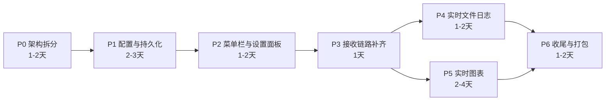

# comtool-rs 功能覆盖评估 · 开发计划 · 可行性报告

| 项 | 值 |
|---|---|
| 被评估对象 | `comtool-rs` 0.1.0，edition 2024，egui/eframe 0.36.1 |
| 对照基线 | `SerialGUI-rs` v1.4.0，edition 2021，egui/eframe 0.31.1 |
| 评估日期 | 2026-09-21 |
| 评估方式 | 全量源码静态审查（comtool-rs 7 个 `.rs` / SerialGUI-rs 20 个 `.rs` + 两边 manifest、构建脚本、文档、许可证文件） |
| 未执行 | 未运行 `cargo check` / `cargo test`（本次仅为只读分析，不影响结论） |

---

## 0. 结论

> **「能用的串口助手」已经完成；「成熟的产品」还差一半。**

| 维度 | 覆盖率 | 说明 |
|---|---|---|
| **串口核心链路**（连接 → 收发 → 显示） | **≈ 90%** | 14 项能力中 12 项完整、1 项部分；**实现质量明显优于上游** |
| **全局功能面**（33 项上游能力） | **≈ 40%** | 完整 12 / 部分 2 / 缺失 19（部分按 0.5 计权） |
| **工程配套**（持久化 · 设置体系 · 图表 · 更新 · 打包） | 改动前 **≈ 0 ~ 12%** → 现 **≈ 90%** | P1 持久化 / P2 设置体系 / P4 文件日志 / P5 图表 / P6 收尾（图标 · release profile · 依赖清理）已完成；**版本检查经所有者决定不做**（内网环境用不上，见 §7 的 P6 行）；未做的是 `env_logger` 与 `vergen` 构建期版本注入 |

**最该先做的三件事**（2026-09-21 修订）：

1. ~~决定 GPLv3 合规怎么处理~~ → **已降为最低优先级**：项目所有者决定先按功能计划推进，合规决策推迟到功能收尾之后（详见 §6 顶部说明）；
2. 拆分 `src/app.rs`（现 1173 行，功能继续堆会失控）—— **✅ 已完成（P0）**；
3. 接上 serde 持久化——依赖已装、`eframe` 的 `persistence` feature 已启用却完全没用，投入产出比最高 —— **✅ 已完成（P1）**。

---

## 1. 基线：SerialGUI-rs v1.4.0 的功能面

按用户可感知能力拆成 10 组共 33 项。

| 组 | 上游文件 | 能力 |
|---|---|---|
| **A 串口连接配置**（7） | `gui/connection_panel.rs` | 刷新端口列表 · 端口选择 · 波特率（20 档 110~3M）· 流控 · 校验位 · 停止位 · 打开/关闭 |
| **B 接收显示**（5） | `gui/rx_panel.rs` | 接收区滚动显示 · 自动滚动开关 · 日志长度上限（默认 30000，FIFO）· 清空输出 · Byte mode（HEX） |
| **C 发送**（2） | `gui/send_panel.rs` | 单行输入 + 发送按钮 · 发送后清空（可配置） |
| **D 文件日志**（2） | `gui/file_log_panel.rs` | 实时写入日志文件（Start/Stop Log）· 文件名可编辑 + 时间戳默认值 |
| **E 实时图表**（1） | `gui/chart_panel.rs` | 逗号分隔数值流实时曲线 |
| **F 顶栏与菜单**（4） | `gui/menu_bar.rs` | File 菜单（Info/Quit）· Settings 菜单 · 主题切换（Light/Dark/System）· 面板显隐互斥勾选 |
| **G 设置项**（6） | `gui/settings_panel.rs`、`generalsettings.rs` | max log length · 默认文件名 · 发送后清空 · 自动滚动 · 启动检查更新 · 重绘间隔（16~1000ms） |
| **H 信息与更新**（2） | `info.rs`、`update.rs` | Info 弹窗 · GitHub 版本检查 + 更新提示弹窗 |
| **I 状态持久化**（1） | `app.rs` | settings + 日志内容 + 图表内容 + 发送内容序列化到磁盘，重启恢复 |
| **J 外观与构建**（3） | `main.rs`、`build.rs` | 应用图标 · `env_logger` · `vergen` 构建期版本注入 |

> 上游另有：`profile.release opt-level=2`、`profile.dev.package."*" opt-level=2`、最小窗口尺寸限制、`guistrings.rs`（仅 2 个字符串的伪 i18n）。

---

## 2. 逐模块对照

| 模块 | 上游能力 | comtool-rs 现状 | 覆盖 |
|---|---|---|---|
| **A 串口连接配置** | 7 项 | **7 项完整**，另多出「数据位选择」，并新增「自动重连」 | **100%** |
| **B 接收显示** | 5 项 | 4 完整 + **日志长度上限缺失** | 80% |
| **C 发送** | 2 项 | 1 完整 + 清空写死、无开关 | 75% |
| **D 文件日志** | 2 项 | 仅有「一次性导出快照」，**两条都缺** | 0% |
| **E 实时图表** | 1 项 | **已重写为多通道**（`egui_plot` + 4~16 通道，上游只有单通道且手绘坐标轴） | **100%+** |
| **F 顶栏与菜单** | 4 项 | 仅一个「⚙ 设置」空壳窗口（内容只有语言占位） | 12% |
| **G 设置项** | 6 项 | **全部缺失** | 0% |
| **H 信息与更新** | 2 项 | **全缺** | 0% |
| **I 状态持久化** | 1 项 | **完全没实现**（`ComTool` 既无 `derive(Serialize)` 也无 `save()`） | 0% |
| **J 外观与构建** | 3 项 | **全缺**（无图标、无 logger、无版本注入） | 0% |

**加权合计**：完整 12 + 部分 2×0.5 = 13 / 33 ≈ **39.4%**

**关键观察**：`serde`、`chrono`、`tokio` 三个依赖已在 `Cargo.toml` 声明却零调用，而它们恰好分别对应 **持久化 / 日志文件名时间戳 / 版本检查**；`eframe` 的 `persistence` feature 也已在 `Cargo.toml` 打开但未使用。**方向已经铺好，只差接线。**

---

## 3. comtool-rs 的净增量（超出上游，务必保留）

| 能力 | 位置 | 价值 |
|---|---|---|
| **ANSI 彩色渲染**（SGR 16 色 / 256 色 / 真彩） | `src/app.rs:130-479` `AnsiDecoder` | 上游仅用 `from_utf8_lossy`，终端彩色输出完全看不到颜色 |
| **字节查看视图** | `src/app.rs:141` `ascii_spans_from_bytes` | 控制字符转义为 `\r` `\n` `\t`、`[0D]`、`\xFF`，调试利器 |
| **跨包 UTF-8 拼接** | `src/app.rs:14` `utf8_complete_prefix_len` | 上游 lossy 解码会撕裂被分包的多字节汉字，这是硬伤修复 |
| **非法字节可见化** | `src/app.rs:392-420` | 非法字节显示为 `[FF]`，而非字体缺字形的 `□` |
| **自动重连**（500ms 节流 + 记住上次端口，避免跳回 COM1） | `src/app.rs:490-519`、`581` | 上游无 |
| **数据位选择**（5/6/7/8） | `src/serial_impl/portsettings.rs:94`、`src/app.rs:897-913` | 上游 `PortSettings` 根本没有 `data_bits` 字段 |
| **工作线程状态机加固** | `src/serial_impl/serial.rs:64, 82, 92-99, 129` | 修掉了上游 `stop()` 在 `Opening` 态**永久 join 死锁**的 bug；并区分 `TimedOut`/`WouldBlock` 与真实错误 |
| **中文字体回退链**（Hack → 雅黑/宋体 → Segoe UI Symbol 盲文） | `src/main.rs:27-75` | 上游无，中文环境直接乱码；且覆盖 U+2800 盲文点阵 |
| **右侧可折叠侧边栏**（串口信息 / 接收统计 / 可用端口列表） | `src/app.rs:782-974` | 上游无 |
| **多行发送区 + Enter 发送 / Shift+Enter 换行** | `src/app.rs:1064-1076` | 上游仅单行输入框 |
| **6 个内联单元测试** | `src/app.rs:1101-1172` | 上游零测试 |
| **右键「复制全部日志」** | `src/app.rs:239-244` | 上游无 |

---

## 4. 缺陷清单（不是"缺功能"，是"已有实现存在问题"）

| 严重度 | 问题 | 位置 | 触发条件 / 影响 | 最小修复 |
|---|---|---|---|---|
| **高** | **接收缓冲无上限**。上游有 `max_log_string_length`（30000）FIFO 淘汰；comtool-rs 的 `receive_text` / `display_spans` / `ascii_spans` **三份镜像只增不减** | `src/app.rs:654-683` | 长时间挂机接收 → 内存持续增长，最终 OOM | 见 §5 阶段 P3 |
| **高** | **`connected` 假阳性**。`open_port()` 中 `start()` 只要线程成功 spawn 就返回 `Ok`，随即 `connected = true`；真正打开失败要等 `Error` 事件回来才置 `false` | `src/app.rs:573-579` | 打开不存在的端口时，UI 会先闪一下"已连接"再变回断开；侧边栏状态与实际不符 | 让 `start()` 等待首次状态确认，或引入 `EPortState::Opening` 的 UI 呈现 |
| **中** | **自动重连无退避**。每 500ms 失败一次就新建一个线程 | `src/app.rs:490-519` | 串口被其它程序占用时，持续高频重试并反复 spawn 线程 | 加指数退避 + 上限次数 |
| **中** | **读取缓冲固定 1024 + `timeout(10ms)`** | `src/serial_impl/serial.rs:81, 59` | 3 Mbps 下每 ≈2.7ms 填满一次，syscall 频次偏高、循环空转 | 提高到 4096~8192；空闲期不必要地阻塞 10ms |
| **中** | **自动滚动写死开启**，无开关 | `src/app.rs:233` | 用户向上翻阅历史日志时会被强制拉回底部 | 加 `auto_scroll` 字段 + 设置项 |
| **低** | `src/config.rs` 是**空文件**；`Language` 枚举已定义但未接线；`egui-chinese-font` 依赖已引入却手写了字体加载 | `src/config.rs`、`src/app.rs:76-79` | 死代码 / 冗余依赖（`tokio` 启用 `full` 但零使用，纯增加编译时间） | 清理或接线 |
| **低** | `eframe` 的 `persistence` feature 已启用但未使用 | `Cargo.toml:8`、`src/main.rs:77` | "已付费未使用"的能力 | 阶段 P1 |

---

## 5. 架构风险与重构建议

**现状**：上游是 `gui/` 下 7 个职责清晰的面板模块；comtool-rs 是单文件 `src/app.rs` **1173 行**（其中约 500 行是 UI 绘制代码）。

现在还能读，但再叠加图表、实时文件日志、设置面板、菜单栏之后必然失控。

**建议**：在阶段 P1 之前先做一次**低风险拆分**——纯移动代码、不改逻辑：

```
src/
├── app.rs          # ComTool 状态定义 + eframe::App 编排 + Default
├── receive.rs      # 三镜像状态 + AnsiDecoder + ascii_spans_from_bytes + 三种渲染
├── sidebar.rs      # 右侧边栏
├── panels/         # 菜单栏 / 设置面板 / 文件日志面板 / 图表面板
└── serial_impl/    # 不动
```

验收标准：`cargo check` + 现有 6 个测试全绿，**行为零变化**。

> 项目自带的 `.opencode/agents/executor.md` 第 56~70 行已经写明：「如果发现任务实际上需要重新设计架构：停止盲目修改，说明 `ARCHITECTURE_REVIEW_REQUIRED`」。这个信号现在就该发出，而不是等 `app.rs` 涨到 2000 行。

---

## 6. 合规风险（**已按所有者决定降为最低优先级**）

> **2026-09-21 决定**：项目所有者明确要求把 GPLv3 合规排到**最低优先级**，先按 §7
> 的功能计划推进。因此本节从"必须先拍板"改为"待办清单里排最后"。
>
> 需要清楚的是：**这不是"风险已消除"，只是"决策被推迟"**。在做任何对外分发（发布、
> 交付、上架）之前必须回到本节二选一。仓库目前仍是**无许可证状态**（无 `LICENSE`、
> `Cargo.toml` 无 `license` 字段），私下自用不受影响。

`SerialGUI-rs` 采用 **GPLv3**（见 `SerialGUI-rs/NOTICE.md`、`SerialGUI-rs/LICENSE-GPLv3`）。

> 注：下面描述的是**改造前**的代码状态。P0 已完成通信层独立重写，`src/` 下已不存在
> 与上游逐字相同的代码段（见 `REFACTOR_REPORT.md` §2.4）；但法律意义上的 clean-room
> 要求重写者从未接触过原实现，这一点在单人会话里无法满足，所以本节结论仍然成立。

而 comtool-rs 的：

- `src/communicationtrait.rs` 与上游 `communicationtrait.rs` **逐字节几乎相同**（连 `CommunicationEvent`、`EPortState`、trait 方法签名与注释都一致）；
- `src/serial_impl/serial.rs` 是明确的衍生物（同样的 `Arc<Mutex<EPortState>>` 结构、同样的 `get_available_connections()` 打印 VID/PID 的调试输出、同样的函数体骨架）；
- `src/serial_impl/portsettings.rs` 的 `BAUD_RATES` 表逐项一致。

两个事实问题：

1. **comtool-rs 根目录没有 `LICENSE` 文件**，`Cargo.toml` 也没有 `license` 字段——一个 GPLv3 衍生作品处于「无许可证」状态。
   （注：`SerialGUI-rs/` 本身被 `.gitignore` 排除，不会随仓库分发；但这不改变 `src/` 内代码的衍生性质。）
2. 按 GPLv3 copyleft，**对外分发时必须以 GPLv3 发布并附完整源码**。若这是要商用或闭源发布的产品，会传染整个项目。

**两条路，必须二选一：**

| 方案 | 做法 | 代价 |
|---|---|---|
| **① 接受 GPLv3** | 补 `LICENSE`（GPLv3 全文）+ `NOTICE` 保留上游署名与来源说明 + `Cargo.toml` 加 `license = "GPL-3.0-only"` | 项目必须开源、GPLv3 分发；后续无法闭源商用 |
| **② Clean-room 重写** | 独立重写 `communicationtrait.rs` 与 `serial_impl/serial.rs`。`CommunicationManager` 这个抽象本身极简单（5 个方法），用不同的内部结构（例如不暴露 `Arc<Mutex<EPortState>>`，改为 `AtomicU8` + `Condvar` 或 `CancellationToken` 风格停机）即可完全脱离衍生关系 | 约 1~2 天；需在干净环境下仅依据需求重写，不参照上游源码 |

> **注意**：comtool-rs 的 `serial.rs` 已经对上游做了实质改进（修了 `Opening` 态死锁、加了 `data_bits`、区分了 `TimedOut`/`WouldBlock`）。方案 ② 重写时**必须保留这些改进**，它们才是项目的真实价值。

**这个决定已由所有者推迟到功能收尾之后**（2026-09-21），但必须在**对外分发之前**
完成二选一，否则越往后迁移成本越高。

---

## 7. 开发计划

> 执行状态见 `HANDOVER.md`（该文档跟踪实际进度、验证证据与偏差）。下表状态列同步于
> 2026-09-21。



| 阶段 | 内容 | 涉及文件 | 验收标准 | 工期 | 状态 |
|---|---|---|---|---|---|
| **P0** 架构拆分 | `app.rs` 拆为 `app.rs` / `receive.rs` / `sidebar.rs` / `panels/`；清理 `config.rs` 空文件 | `src/**` | `cargo check` + 6 个测试全绿，行为零变化 | 1-2 天 | ✅ 完成（29/29 逐行等价） |
| **P1** 配置与持久化 | 引入 `pub struct AppSettings`（serde 现成）；`ComTool` derive `Serialize/Deserialize`，`serial` / `event_rx` / `decoder` / `Instant` 全部 `#[serde(skip)]`；实现 `fn save()` | 新增 `src/settings.rs`；改 `src/app.rs`、`src/main.rs` | 改设置 → 退出 → 重启，设置全保留 | 2-3 天 | ✅ 完成（未做磁盘实测） |
| **P2** 菜单栏 + 设置面板 | 顶部 `TopBottomPanel`：File(Info/Quit) · Settings（真正接线的设置项）· 主题切换 · Byte mode · 面板显隐互斥（至少保留一个面板） | `src/panels/menu_bar.rs`、`src/panels/settings.rs` | 上游 F 组 4 项 + G 组 6 项全部可用 | 1-2 天 | ✅ 完成（实际用 `egui::Panel::top`，egui 0.36 已无 `TopBottomPanel`；G 组 2 项待 P4/P6 消费，界面已标注） |
| **P3** 接收链路补齐 | `max_log_string_length` FIFO 淘汰（**三镜像同步淘汰，注意 `ColoredSpan` 需支持部分切分**）；`auto_scroll` 开关；可选时间戳前缀 | `src/receive.rs` | 挂机 1 小时内存稳定；上游 B 组 100% | 1 天 | ✅ **完成**：FIFO + `auto_scroll`（提前随 P2 落地）+ 可选时间戳前缀（`TimestampPrefix::{Off, PerLine, PerBatch}`，默认关闭，见 `HANDOVER.md` §3.5） |
| **P4** 实时文件日志 | Start/Stop Log 开关；默认文件名 `LogFile_%Y-%m-%d_%H-%M-%S.txt`（chrono 现成）；**写入走独立线程 + `BufWriter`，绝不在 UI 线程 `write_all`** | `src/panels/file_log.rs` | 开启后数据实时落盘，UI 无卡顿 | 1-2 天 | ✅ 完成（落在 `src/log_file.rs`，另含目录选择与同名防截断） |
| **P5** 实时图表 | 建议引 `egui_plot` 而非移植上游手绘代码；支持逗号分隔多通道；`stream_buffer` 处理跨包分片；样本上限可配 | `src/panels/chart.rs` | ≥4 通道实时曲线 + 自动缩放 | 2-4 天 | ✅ 完成（数据层落在 `src/chart.rs`、绘制层在 `src/panels/chart.rs`；16 通道上限、绘制点封顶 4000、缺通道断线而不补 0） |
| **P6** 收尾 | Info 弹窗；版本检查（**默认关闭或超时 3s 静默失败**，内网环境要能跳过）；应用图标；`[profile.release] opt-level = 2`；清理未使用依赖；补文档 | `src/info.rs`、`src/update.rs`、`Cargo.toml`、`src/app_icon.rs` | 上游 33 项覆盖率 ≥ 85% | 1-2 天 | ✅ **除版本检查外全部完成**：Info 弹窗 ✅；依赖清理 ✅（移除 `tokio`、`egui-chinese-font`）；release profile ✅；应用图标 ✅（代码绘制、11 测试）。**版本检查：所有者决定不做**，`check_update_on_start` 设置项与其设置段落已一并删除（界面上不留无效开关，见 `HANDOVER.md` §3.5）。仅剩既有 clippy 警告清理 |

**总工期估算：10 ~ 17 个工作日**（单人，含调试与回归）。

**里程碑**：P2 完成 → 覆盖率约 75%，达到"可日常使用"；**P5 完成 → 约 88%，达到"功能对齐上游"**；
**P3 + P6 两批完成 → 约 90%，计划内功能项全部落地**（唯一明确不做的是版本检查）。
2026-09-21 又顺手修掉一个既有缺陷（「HEX 接收 + 字节查看」同时勾选时字节视图为空，改为两者互斥，
见 `HANDOVER.md` §3.6）。剩下的都不是功能开发：磁盘持久化实机验证（需所有者亲手跑）、
GPLv3 合规二选一（最低优先级）、既有 clippy 警告清理、以及「颜色 + 字节查看」的显示优先级决策。

---

## 8. 可行性报告

### 技术可行性：高

- 技术栈已完全跑通（egui 即时模式 + serialport 后台线程 + mpsc 事件通道），所有待补功能都是「纯状态 + 纯 UI」，无未知技术。
- **依赖状态**：serde（持久化）、chrono（文件名与接收时间戳前缀的格式化）、`egui_plot`（图表）已就位并真正使用；`eframe` 的 `persistence` feature 已开启。`tokio` 与 `egui-chinese-font` 已作为死依赖移除（见 P6 第 1 批）。**版本检查已决定不做，因此"唯一可能需要新增依赖的点"也随之消失——当前依赖集是最终形态**（要恢复版本检查才需要重新评估 HTTPS 客户端）。
- 图表是唯一有实现选择的分支，但 `egui_plot` 是成熟 crate，风险低。
  **已落地（P5）**：`egui_plot 0.37.0` 依赖 `egui ^0.36`，与本项目 0.36.1 匹配，
  不需要走"移植上游手绘"的退化方案。**注意它的版本号与 `egui` 并不同步**——
  `egui_plot 0.36` 依赖的是 `egui ^0.35`，升级前必须核实真实依赖而不是比数字。

### 风险矩阵

| 风险 | 等级 | 影响 | 对策 |
|---|---|---|---|
| **GPLv3 合规** | **低**（原「高」，2026-09-21 推迟） | 决定项目能否闭源/商用；**对外分发前必须解决** | 已降为最低优先级，见 §6；分发前二选一 |
| `app.rs` 已 1173 行，继续堆会失控 | 中高 → **已解除** | 后续每个功能改造成本递增 | P0 已拆分，拆完 434 行；至 2026-09-21 随 P1/P2/P5 与显示模式修复增长到 613 行 + `panels/` |
| 三镜像（`receive_text`/`display_spans`/`ascii_spans`）同步淘汰易出错 | 中 → **已缓解** | 日志与显示不一致 | 淘汰收敛到唯一入口 `trim_receive_logs()`，边界切分有单元测试 |
| 实时文件日志阻塞 UI 线程 | 中 → **已缓解** | 高波特率下界面卡死 | 写盘在独立线程 + `BufWriter`；待写队列有上限，满了停下报告而不是吃内存（P4） |
| 版本检查在离线/内网不可用 | ~~低~~ **已消除** | 启动卡顿 | 所有者决定**不做版本检查**，设置项与复选框一并删除（2026-09-21）——内网环境本就访问不到检查地址，留一个永远失败的开关比没有更糟 |
| 持久化反序列化在版本升级后不兼容 | 低 | 启动 panic 或丢设置 | `#[serde(default)]`，字段只增不删；**删字段同样安全**（忽略未知键），`config::tests::archive_with_a_removed_field_still_loads` 已固定 |
| 上述单元测试覆盖不足 | 低 → **已缓解** | 回归发现不了 | 测试数 6 → 19 → 34 → 50 → 79 → 90 → 110 → **116**（含接收链路、裁剪边界、时间戳前缀、显示模式互斥、面板无头 UI、日志落盘、图表解析与上限、应用图标几何/颜色/透明度） |

### 资源需求

单人全栈即可；**无服务端、无数据库、无任何外部 API 依赖**（版本检查已取消，程序全程不联网）；无云成本。仅需 Rust toolchain（edition 2024，需 Rust 1.85+）。

### 验证策略

沿用仓库既有约定（`AGENTS.md` 第 9 行）：`cargo check` → `cargo test` → `cargo fmt --check`。建议补充：

- `cargo clippy`（上游开了 `#![warn(clippy::all, rust_2018_idioms)]`，comtool-rs 未开）；
- 淘汰逻辑的边界测试（span 被从中间截断）；
- 持久化的往返测试（serialize → deserialize → 字段一致）。

---

## 9. 不建议做的事

1. **不要为了"对齐上游"删掉自己的优势。** 彩色 ANSI、字节视图、跨包 UTF-8 修复、自动重连、数据位选择、中文字体链——这些是相对上游的护城河，上游没有。**只补缺口，不砍特长。**
2. **不要移植上游的接收渲染实现。** 上游 `rx_panel.rs:28` 每帧执行 `self.content.iter().collect::<String>()` 重建整个字符串（30000 字符下每帧分配 30KB），是明确的反模式；comtool-rs 的 `ColoredSpan → LayoutJob` 方案明显更优。
3. **不要移植上游的 `stop()`。** 上游只在 `state == Open` 时才置 `Closed`（`serial_communication.rs:110`），`Opening` 阶段点关闭会永久 `join` 死锁。comtool-rs 已修复（`serial.rs:129`），不要退回。
4. **不要移植上游的图表代码。** 它只有单通道、把多列数据全混进同一条曲线，且保留了从未使用的 `content: VecDeque<char>` 字段（`chart_panel.rs:6`）。用 `egui_plot` 重写更快也更好。
5. **不要为了通过编译而 `clone()` / 加锁 / 加 `unwrap()`。** 项目自带的 executor 提示词第 70 行明确要求"不要为了让任务看起来完成而使用临时补丁掩盖架构问题"。

---

## 附录：关键代码坐标速查

| 主题 | comtool-rs | SerialGUI-rs |
|---|---|---|
| 状态定义 | `src/app.rs:278-327` | `src/app.rs:13-35` |
| 默认值初始化 | `src/app.rs:723-756` | `src/app.rs:37-59` |
| UI 主循环 | `src/app.rs:758-1098` | `src/app.rs:155-205` |
| 串口事件处理 | `src/app.rs:633-684` | `src/app.rs:106-147` |
| 打开/关闭串口 | `src/app.rs:546-615` | `gui/connection_panel.rs:123-150` |
| 串口工作线程 | `src/serial_impl/serial.rs:38-123` | `src/serial_impl/serial_communication.rs:30-105` |
| 通信抽象层 | `src/communicationtrait.rs`（39 行） | `src/communicationtrait.rs`（39 行，内容几乎一致） |
| 接收渲染 | `src/app.rs:213-276, 686-720` | `gui/rx_panel.rs:18-43` |
| 内联测试 | `src/app.rs:1101-1172` | 无 |
