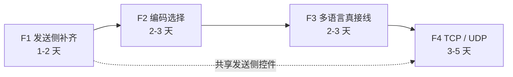

# 未来开发计划 — 向 `Neutree/COMTool` 的差距收敛（F1 ~ F4）

| 项 | 值 |
|---|---|
| 制定日期 | 2026-09-21 |
| 对比基线 | `Neutree/COMTool`（Python 3 + PyQt5，约 2600 stars） |
| 本文件性质 | **新开的一条计划线**，与已收口的 P0~P6 无重叠 |
| 当前状态 | `ai-refactor` 分支，HEAD 工作区干净；门禁 0 warning / 115 通过 + 1 忽略 / fmt 干净 |
| 未执行 | 未运行本项目、未触碰任何串口（遵守 `AGENTS.md` 顶部红线） |

---

## 0. 结论

> **在 COMTool 的差距里，只有 4 项值得做；其中 1 项（发送侧）是"每天都会用到"的刚需，
> 另外 3 项各有一条明确的排除理由之外的成本账。**

按性价比（日常收益 ÷ 改动成本）排序：

| 序 | 项 | 收益 | 成本 | 结论 |
|---|---|---|---|---|
| **F1** | 发送侧补齐（HEX 发送 / 行尾 / 定时发送 / 发送历史） | **高**（每天用） | **低**（纯 UI + 纯函数，零新依赖） | ✅ **第一优先** |
| **F2** | 编码选择（GBK / GB18030） | 中高（国内设备常发 GBK） | 中（解码层改造 + 1 个新依赖） | ✅ 纳入 |
| **F3** | 多语言真接线（`Language` 枚举已在位） | 低（单用户内网场景） | 中（横向扫全库文案） | ✅ 纳入，排后 |
| **F4** | TCP / UDP 客户端 | 中（换调试对象时才用） | 中高（界面分叉 + 连接生命周期） | ✅ 纳入，排最后 |
| ~~⑤~~ | 插件架构（**扩展机制本身**） | 未知 | **极高**（要改掉单 binary 的形态） | ❌ **明确不做**，见 §8 |
| **D1~D3** | SSH / terminal 插件 / 协议脚本 | 未知 | 高（各自独立立项） | ⏸️ **待定开发**（未排期），见 §7 |

外加 3 个**既有缺陷**顺带处理（不另开阶段，见 §10）：`connected` 假阳性、自动重连无退避、
待发队列无上限——它们与 F1/F4 改的是同一条路径，一起做比单独做便宜。

---

## 1. 基线澄清（**先读这一节**）

本仓库的文档里出现过**两个不同的"上游"**，覆盖率数字**不可混用**：

| 对照基线 | 覆盖率 | 含义 | 出处 |
|---|---|---|---|
| `SerialGUI-rs` v1.4.0（Rust + egui，GPLv3） | **约 90%** | 本项目 P0~P6 的原始基线，计划内功能项已全部落地 | `FEATURE_GAP_AND_PLAN.md` |
| `Neutree/COMTool`（Python + PyQt5） | **约 49%**（26/53 项，按源码清点） | 差距不在"串口助手"，而在"平台化" | **本文件** |

两者**没有血缘关系**，只是同名同类。`Neutree/COMTool` 规模比 `SerialGUI-rs` 大一个量级，
把它当基线时覆盖率自然掉到一半——这不代表项目退步，而是**比较口径变了**。

本文件只讨论"向 COMTool 收敛"这一条线，**不修改** `FEATURE_GAP_AND_PLAN.md` 里那套
相对 `SerialGUI-rs` 的数字。

---

## 2. F1 · 发送侧补齐（第一优先）

### 现状

发送侧目前只有一条最小通路：

- `src/app.rs:340` `send_data()`：`send_text.as_bytes().to_vec()` → `ByteChannel::write()`；
- `src/app.rs:568-605` 发送区 UI：多行输入框 + 「发送」/「清空发送」按钮 + Enter 发送
  （Shift+Enter 换行）；
- `src/panels/settings.rs:97-98`：唯一一个发送相关设置项「发送后清空输入框」。

对照 COMTool 的 dbg 插件，发送侧缺：**HEX 发送、追加换行、CRLF/LF 选择、定时发送、
发送历史、发送文件**。其中前三项是"没有就得手动改数据"的硬缺口。

### 逐项设计约束

**① HEX 发送**

- 新增 `SendFormat::{Text, Hex}`。用枚举而不是 `send_hex: bool`：本项目已有先例
  （`TimestampPrefix` 的三个值用枚举表达，"而不是两个 bool"，见 `receive.rs`）。
- 解析抽成**纯函数** `parse_hex_send(&str) -> Result<Vec<u8>, String>`，便于单测。
  允许分隔符：空格 / 逗号 / 换行 / 可选 `0x` 前缀。
- **非法输入必须报错，不许静默丢弃**：奇数个十六进制位、含非十六进制字符时，
  **不清空输入框、不发送**，并在接收区给出一条提示（复用 `push_receive_note`，
  与现有的 "发送失败: {e}" 走同一条通道）。
  理由：静默丢掉半个字节，用户会以为设备有问题，排查成本远高于一条提示。
- **与「字节查看」无关**：HEX 发送是"输入的解析方式"，不是"显示的解析方式"，
  不要和 `hex_view` / `ascii_view` 那套互斥规则混在一起（那套规则只作用于接收）。

**② 行尾（追加换行 / CRLF）**

- 新增 `SendLineEnding::{None, Lf, Crlf}`。
- **必须在字节层追加，不是字符层**：先由当前格式（文本 / HEX）算出 `Vec<u8>`，
  再在尾部 `push(0x0A)` 或 `push(0x0D); push(0x0A)`。
  在字符串上追加 `"\r\n"` 再编码，在 HEX 模式下语义直接错乱。
- 顺序无关但**只有一处实现**：`send_data()` 里"编码 → 追加行尾 → write"成为唯一入口，
  不要在按钮回调里各写一遍。

**③ 定时发送**

- 新增 `repeat_send: bool`（**默认 false**）+ `repeat_interval_ms: u64`（夹到 10 ~ 600000）。
- **禁止在 UI 线程 `sleep`**。用 `#[serde(skip)] last_repeat_send: Option<Instant>`，
  在 `update()` 里比较 `elapsed()`。
- **不要为此把重绘间隔钉死**：只在勾选定时发送时 `ctx.request_repaint_after(剩余时间)`，
  未勾选时不请求。否则它会和设置里的「重绘间隔（16~1000ms）」互相打架，
  用户把重绘间隔调到 500ms 却发现程序仍在 10ms 空转。
- **断开连接时必须自动停掉**。否则重连成功后会在用户毫无预期的情况下开始喷数据。
- **不跨进程延续**（`#[serde(skip)]` + 默认关闭）：与「实时文件日志不自动开始」同一条
  理由——`src/config.rs` 模块注释已经把这条原则写死了，新功能必须遵守。

**④ 发送历史**

- `send_history: Vec<String>`，上限 50，FIFO 淘汰；**落盘**（它属于用户偏好）。
- 连续发送同一条内容时不重复入栈（去重只看"最近一条"）。
- **键位冲突是真实成本点**：↑/↓ 在 `egui::TextEdit::multiline` 里默认是移动光标。
  必须限定"**光标位于第一行时按 ↑ 才取历史**"（反之 ↓ 限定在最后一行），
  否则会抢走正常的光标移动，比没有历史更难用。当前 Enter 已被用作发送
  （`app.rs:577-584`），可用键位本就紧张，实现前先把这两条规则写成注释。

**⑤ 发送文件（可选，建议最后做或不做）**

- 若做：必须**分块读 + 分块写 + 界面显示进度**。
- 直接 `std::fs::read` 一个几百 MB 的文件塞进待发队列，会同时爆内存和队列——
  待发队列目前**没有上限**（见 §10）。而给它加背压本身是独立的一件事，
  建议先做背压再做发送文件，不要反过来。
- 文件选择复用已有依赖 `rfd`（`pick_log_dir` 已经在用）。

**不做**：COMTool 的 "Key mode"（按键直接映射成字节流）——它等价于一个终端，
属交互范式而非数据调试（见 §6），且与 §7 的 **D2（terminal 插件）**同源，
**D2 一旦立项它就跟着走**，不单独做。

### 涉及文件

`src/app.rs`（状态 + `send_data()` + 发送区 UI）、`src/panels/settings.rs`（发送段扩写）、
新增 `src/send.rs`（HEX 解析 / 行尾 / 历史，纯逻辑，可单测）。

### 验收标准

- HEX 发送：`48 65 6C 6C 6F` / `48,65,6c,6c,6f` / `0x48 0x65` 三种写法都发出
  `Hello` 的字节；`4` 或 `0xZZ` → 不发送 + 接收区有提示 + 输入框内容保留。
- 行尾：`None` / `LF` / `CRLF` 三档在文本与 HEX 两种格式下发出的字节都正确
  （HEX 模式下行尾是 `0x0A` / `0x0D 0x0A`，不是字符）。
- 定时发送：间隔 100ms 时每秒约 10 条；断开连接后自动停止；重启程序后处于未勾选状态。
- 历史：连发 5 条不同内容后按 ↑ 依次取回；同一条连发两次只占一条历史；
  在任何非首行位置按 ↑ 仍是光标上移。
- 全部新逻辑都有**不需要串口硬件**的单元测试（这是本项目的既有约定）。

### 成本与风险

成本低（1~2 天）：全是纯状态 + 纯 UI，无新依赖，无新线程。
风险：定时发送的时间基准若实现成"每帧累加"，在高帧率下会漂移——必须用 `Instant` 差值。

---

## 3. F2 · 编码选择（GBK / GB18030）

### 现状与硬约束

接收链路目前**固定 UTF-8**，并且这一点做得比 COMTool 好：
`receive.rs:56 utf8_complete_prefix_len` + `receive.rs:227 flush_utf8` 实现了**跨包拼接**
（被分包的多字节汉字不会被撕裂），非法字节以灰色 `[XX]` 显示而不是 U+FFFD。

> **所以 F2 的真正难点不是"加个编码选项"，而是"加编码之后不能把上面这条优势弄丢"。**
> 如果实现成"收到一批就 `lossy` 解一次"，就退化回了 COMTool 的水平。

COMTool 支持 ASCII / UTF-8 / UTF-16 / GBK / GB2312 / GB18030 六档。

### 方案

- 新增 `pub enum TextEncoding { Utf8, Gbk, Gb18030, Utf16Le }`（放 `src/receive.rs`，
  与解码策略同处）。**不单列 ASCII**（它是 UTF-8 的子集，没有独立语义）；
  **不单列 GB2312**（是 GBK 的子集，用 GBK 一档即可覆盖）。
- **必须用增量解码**：引 `encoding_rs`（Mozilla 维护、纯 Rust、无 C 依赖），
  用它的 `Decoder::decode_to_string_without_replacement` + `has_pending`
  维护跨包状态，**不要手写各编码的"完整字符前缀长度"判定**——这类边界判断
  UTF-8 一份就够难写了，GBK/UTF-16 各写一份是纯粹的 bug 农场。
- **生效范围要一次说清**：接收（三种视图 + 时间戳前缀 + 导出 + 实时日志）**和**发送
  （把 `send_text` 按所选编码编成字节）。发送侧编码与 F1 的 HEX 模式互斥——
  HEX 模式直接产出字节，不经过编码。
- 现有 `AnsiDecoder` 的彩色解析（`ESC[...m`）建立在"已解码文本"之上，
  因此**编码解码必须发生在 ANSI 解析之前**，顺序不能反。
- 切换编码时**必须清空 `pending_utf8` 之类的跨包残留**，否则会把上一种编码的半截
  字节用新编码解一遍，输出一段随机汉字。这是一条容易漏掉的边界。

### 新增依赖的连带影响（**要同步改文档**）

`FEATURE_GAP_AND_PLAN.md` §8 写着"当前依赖集是最终形态"——**那条结论
只在"不做 F2"时成立**。若采纳 F2，这一句必须改成"除 `encoding_rs` 外为最终形态"，
并同步 `HANDOVER.md`。这也是 F2 而不是 F1 排第二的原因之一：它打破了一条已写下的承诺。

### 验收标准

- GBK 中文设备发"你好"（`C4 E3 BA C3`）→ 接收区显示"你好"；**把它拆成
  `C4` + `E3 BA C3` 两批发出，仍然显示"你好"**（跨包拼接不回退）。
- 切到 GB18030 / UTF-8 → 同一条数据的行为符合预期；切回 UTF-8 后，输出与本功能
  上线前逐字节一致。
- 发送侧：文本"你好"在 GBK 档下发出 `C4 E3 BA C3`。
- 单元测试：三种编码各覆盖"完整 / 跨包截断 / 非法字节"三种输入。

### 成本与风险

成本中（2~3 天）：解码层改造 + 设置项 + 发送侧编码。
风险：`encoding_rs` 对 UTF-16 的 BOM 处理与"无 BOM 小端"默认值需要实测确认；
若设备需求不明确，第一版可先只做 GBK / GB18030，把 UTF-16 留到有明确设备再做。

---

## 4. F3 · 多语言真接线

### 现状

`Language` 枚举已在位（`app.rs:25`），设置窗口也有下拉（`settings.rs:55-63`），
但唯一的"实现"是紧跟其后的一句 `ui.weak("语言选项尚未接入界面文案，仅作占位")`。
全库文案硬编码中文，散落在 `app.rs` / `panels/*` / `sidebar.rs` / `receive.rs`。

### 方案

- **不用 gettext**：它是运行期字符串查找，漏翻译只有运行时才会暴露。
- 用 `src/strings.rs`：`struct Strings { /* 每个文案一个命名字段 */ }` +
  `static ZH: Strings` / `static EN: Strings` + `impl Language { fn strings(self) -> &'static Strings }`。
  **漏翻译 = 编译错误**（新增字段时两个实例都必须补齐），这正是想要的性质。
- egui 的控件直接吃 `&str`，零额外机制，不需要宏。

### 必须写进注释的一条界面决策

**接收区里由程序写出的提示行**（`receive.rs` 的 "串口已关闭\n"、发送失败提示、
`app.rs` 的 "已导出到: …"）**不翻译**。

理由：这些文字会被同步写进**实时日志文件与导出文件**。如果它们随界面语言变化，
同一台设备在两个语言设置下产出的两份日志就不可比（也不可被 grep 脚本处理）。
**只翻译 UI 控件文案，接收区与日志内容保持固定文字。**

### 验收标准

- 切到 English 后，菜单栏 / 设置窗口 / 侧边栏 / 面板标题全部为英文，无中文残留。
- 切回中文后与原界面逐字一致。
- 接收区里的"串口已关闭"等提示行**两种语言下都保持中文**（按上面的决策）。

### 成本与风险

成本中（2~3 天）：改动面大（约 150+ 处字面量）但机械。
风险低，**收益也低**——单用户内网场景下这条几乎不影响可用性，所以排在 F1/F2 之后。
真正的价值在于：一旦将来要给别人用，这是唯一无法"顺手补"的一项（它必须一次性扫全库）。

---

## 5. F4 · TCP / UDP 客户端

### 架构口子已确认存在（不是"应该能扩展"，是"已经留好了"）

| 证据 | 位置 |
|---|---|
| 字段类型已经是 trait 对象，**不是** `Option<SerialChannel>` | `src/app.rs:110` `pub serial: Option<Box<dyn ByteChannel>>` |
| 抽象只有 5 个方法：`open` / `close` / `is_active` / `write` / `configure` | `src/communicationtrait.rs:39` |
| `ChannelEvent::Closed` 分支已存在，注释写明"保留给对端能够主动握手下线的传输（**如 TCP**）" | `src/communicationtrait.rs:25-30`（当前是 `#[allow(dead_code)]`） |
| 后台线程 + `mpsc` 事件的实现模板 | `src/serial_impl/channel.rs`（368 行） |

**实现 TCP 正好把这个 `dead_code` 消掉**——`Closed` 从"为将来预留"变成"真的有人发"。

### 范围

- 新增 `src/net_impl/{mod.rs, tcp.rs, udp.rs}`，模板照 `serial_impl/channel.rs`。
- 第一版做 **TcpClient + Udp** 两项即可，覆盖绝大多数点对点调试场景。
- **第一版不做**：TCP Server（多客户端管理）、命名管道——它们要求"一个通道对象管多个
  对端",与 `ByteChannel` 的单通道契约不符，是独立课题。
- **SSH 不在本项内**：它已列为 **§7 的 D1（待定开发）**，触发条件与前置依赖见那一节；
  D1 会复用本项建立的"连接类型分叉"框架，所以**先做 F4，D1 才便宜**。

### 三个必须写进设计的语义陷阱

1. **UDP 无连接**，`is_active` 只能表达"socket 已绑定"。UI 上**不能沿用"已连接"这个词**，
   建议按连接类型分叉文案（UDP 显示"已绑定 <本地端口>"）。否则用户会以为 UDP 也有握手。
2. **`Failed` 与 `Closed` 必须区分处理**：`receive_data()` 现在只有 `Failed` 一条分支
   （置 `connected = false` 并提示）。TCP 对端正常关闭走 `Closed`，需要补一条分支
   （或统一为"连接已结束"）。不补的话，对端优雅关闭时界面会一直显示"已连接"。
3. **串口专属控件必须随连接类型分叉**：端口列表 / 波特率 / 数据位 / 校验位 / 流控，
   在 TCP / UDP 模式下要整段隐藏或替换成"地址 + 端口"。这是本项**主要的成本来源**——
   不是因为难，而是因为要检查每一处 `self.baud_rate` / `self.selected_port` 的使用点。

另外一条决策：**第一版不给 TCP 自动重连**。现有 `auto_reconnect` 依赖"记住上次端口"
（`last_opened_port`），是串口语义；给 TCP 加上会在对端未启动时产生半死不活的 socket 状态，
收益不明确。

### 新增依赖

**0 项**——`std::net` 足够。这正是 F4 性价比不错的原因；但它比 F1/F2 的改动面大，
所以仍排在最后。

### 验收标准

- 本机起 `nc -l 1234`，用 TCP 模式连上，双向收发正常（含中文与 HEX 视图）。
- 对端关闭 → 界面回到未连接状态，且有明确提示（不是静默卡在"已连接"）。
- UDP 模式发数据到 `nc -u -l 1234`，能收到。
- **可在 `cargo test` 内自动验证**：用 `std::net::TcpListener` 起本地回环，
  写一条集成测试覆盖"连上 → 收发 → 对端关闭 → 状态复位"。
  这一点很有价值——TCP 是本计划里**唯一能在门禁内被自动验完**的网络功能，
  不需要串口硬件，符合本项目"测试不依赖硬件"的既有约定。

### 成本与风险

成本中高（3~5 天）：连接生命周期 + 界面分叉 + 状态文案。
风险：`SerialConfig` 的 `configure(&dyn Any)` 向下转型模式要复制到网络侧
（用相同做法即可，不必改 trait）。

---

## 6. 排除说明（**明确不做**，不属任何计划）

> 与 §7 的区别：本节是**已经决定不做**（且有理由），§7 是**尚未决定**（时机未到，不排除）。

| 能力 | 不做的理由 |
|---|---|
| **自动更新**（`autoUpdate.py`） | 已在 P6 由所有者明确取消（内网环境访问不到检查地址），不重新讨论 |
| **打包与 CI**（`pack.py` / snapcraft / 5 个 release workflow） | 与"对外分发"绑在一起，而分发的前置是 §11④ 的 GPLv3 二选一，尚未拍板 |
| **graph 插件的"二进制带 header 协议"** | 需要为每种设备写解析代码；我们现有的"一行一组、逗号分隔"多通道格式是通用做法，且通道上限/抽样策略比 COMTool 更强 |
| **Key mode / 自定义常用项快捷键** | 属终端交互范式，与 §7 的 D2（terminal 插件）同源；**若 D2 立项则它跟着走**，不单独做 |

---

## 7. 待定开发（Pending，未排期）

> **2026-09-21 修订**：以下三项从"明确不做"**改为待定**。它们不是被否决，而是
> **时机未到**——每项都有明确的"什么条件下值得做"。三者的共同点是**都基于串口这条
> 已有通路**，因此**不需要插件机制**（§8 不做的只是扩展机制本身，不是这三项）。

| 序 | 项 | 是什么 | 为什么现在不做 | **触发条件**（满足任一即值得立项） | 前置依赖 |
|---|---|---|---|---|---|
| **D1** | **SSH** | 通过 SSH 连到远端主机，在远端 shell 上收发 | 与"调试串口数据"是两件事；且需要密钥/密码/known_hosts 等一整套认证 UI | 出现"设备挂在一台只能 SSH 进去的机器后面，要在本地调试它的串口"的真实场景 | F4 的 `ByteChannel` 化改造（D1 与 F4 共用连接类型分叉的框架） |
| **D2** | **terminal 插件**（COMTool 约 740 行） | 把串口当成一个交互式终端：本地回显、行编辑、光标控制、按键直通 | 它是"在串口上跑一个终端"，而本项目定位是"调试串口数据"；要做就得先有 ANSI 光标/清屏（我们现在只解析 SGR 颜色） | 出现"设备侧跑着 shell / bootloader 命令行，需要交互操作"的真实场景 | 无（可独立做）。`receive.rs::AnsiDecoder` 需从"SGR 颜色"扩到 CSI 光标控制 |
| **D3** | **协议脚本**（COMTool 的 protocol 插件） | 用户可编辑的编解码脚本：输入按脚本 pack 后发出，收到的帧按脚本 unpack | 需要先有一套**稳定的宿主 API**（脚本能看到什么、能改什么）与脚本引擎依赖；而当前**还没有第二个真实协议**需要接 | 出现**第二种设备协议**，且它与现有"逗号分隔数值流"格式无法用配置表达时 | 建议**先试 §8 末尾的"配置化协议预设表"**；它能覆盖的场景就不要上脚本 |

**这三项都不做时的替代**（同样可用，成本低一个量级）：

- D1 → 用系统 `ssh` 客户端 + 本地串口工具两条命令各管一头；
- D2 → 用 COMTool / PuTTY 做交互，本项目只做数据侧分析；
- D3 → 见 §8 末尾的配置化协议预设表。

---

## 8. 明确不做：插件架构（扩展机制本身）

> 排除的是**"运行期可加载插件"这套机制**，不是 §7 里那三项具体能力。
> 理由不是"没时间"，而是"与现有形态互斥"。

**COMTool 的做法**：插件是 Python 模块，运行期 `import` 后**直接往 Qt 界面里注入控件**，
宿主与插件共享语言运行时与控件体系，因此"插件"几乎零成本。

**Rust 里的等价物只有两条路，都很贵**：

1. **dylib 动态加载**：Rust **没有稳定 ABI**。跨 dylib 传递 `Box<dyn Trait>`、
   让 panic 穿过边界、让两侧分配器配对释放，都是实际的不安全点；还要求宿主与插件
   **用同一套编译器与同一份依赖图**构建。实践中它换来的是一个随时会崩的扩展点。
2. **内嵌脚本引擎**（rhai / lua）：成本是可接受的，但要求先定义一套**稳定的宿主 API**
   （插件能看到什么、能改什么、生命周期归谁），这实际上等于**先重构 UI 与状态管理的主干**。

**与现有形态的冲突**：项目从 P0 起刻意建立的性质是——单 binary、零资源文件、
**全部行为可被 `cargo test` 覆盖**、状态集中在 `ComTool` 且持久化策略单一。
插件架构要求"运行期可扩展"，这三条会同时失效。

**收益侧也不成立**：插件体系的价值在于"多设备、多协议各自演进、互不干扰"。
本项目当前是**单设备调试工具**，没有第二个协议要接。

**若将来真的需要协议扩展**，有一个成本约 1/20 的替代方案：
**配置化的协议预设表**——把 CRC16（IBM / MODBUS）、帧头帧尾、字段布局用**数据**描述
而不是代码，内置几种常用帧格式让用户选。它不需要动态加载，仍然可单测。
**本文件不含此项**，仅作记录：它是 §7 里 **D3（协议脚本）的首选替代**，
等真有第二台设备的协议需求时，**先试它，再考虑 D3**。

---

## 9. 建议节奏

- **F1 必须先做**：它是日常使用频率最高的一项，且 F4 会复用它的发送区控件。
- **F1 与 F2 有一处接口交叉**：发送侧编码（F2）落在 F1 建立的"编码 → 追加行尾 → write"
  这条唯一通路上。顺序上先做 F1，F2 接进来时只需替换"编码"那一步。
- **F3 可以随时插入**，它与其它三项零耦合，但改动面大，建议在没有其它并行改动时做。
- **F4 放最后**：它是唯一需要动"连接生命周期"的一项，前置最少，但也最该在
  发送侧（F1）稳定之后再动。

**总工期估算：8 ~ 13 个工作日**（单人，含调试与回归）。

**§7 的 D1~D3（SSH / terminal / 协议脚本）不进这条流水线**：它们各自独立立项，
触发条件见 §7 的表。D1 会复用 F4 的连接类型分叉框架，D3 建议先试配置化协议预设表。

---

## 10. 顺带项：与本计划同路径的既有缺陷

这 3 条不是新功能，但**改的是 F1 / F4 要动的同一段代码**，一起做比之后单独做便宜
（来源：`HANDOVER.md` §5）。

| 严重度 | 问题 | 位置 | 与哪项同路径 |
|---|---|---|---|
| **高** | `connected` 假阳性：`open()` 只要线程 spawn 成功就置 `connected = true`，真正失败要等 `Failed` 事件回来 | `app.rs::open_port` | **F4**（TCP 重写连接建立流程时顺手解决） |
| 中 | 自动重连无退避：每 500ms 失败就新建一个线程 | `app.rs::auto_reconnect` | **F4**（TCP 第一版不做重连，但退避逻辑该先补） |
| 中 | 待发队列无上限：设备长期不可写 + 用户持续发送时队列增长 | `channel.rs::worker_main` 的 `outgoing` | **F1**（做定时发送/发送文件之前必须先有背压） |

> **注意**：待发队列的背压是 F1 里「发送文件」一项的**前置条件**，不是可选项。
> 在没有背压的队列上按 10ms 间隔定时发送，等于给一个无底洞灌数据。

---

## 11. 非功能性待办（沿用 `HANDOVER.md` §4 / §5，不属本计划）

| 优先 | 事项 | 说明 |
|---|---|---|
| **最高** | 磁盘级持久化**从未实测** | 单元测试走的是内存版 `eframe::Storage`；真实文件读写需所有者亲手跑一遍（步骤见 `HANDOVER.md` §4②）。**同一趟可以顺带验掉 P3/P4/P5** |
| 中 | 8 条既有 clippy 风格警告 | `cargo clippy --fix` 可一键清掉，但会改到本任务之外的代码，建议单独一次提交 |
| 中 | 「颜色 + 字节查看」同时勾选的显示优先级 | 字节查看被彩色视图盖住（**不丢内容**）。最小修法：二选一——让字节视图优先，或勾上时把「颜色」置灰。需一次界面决策 |
| 最低 | GPLv3 合规二选一 | 决策已推迟，**风险未消除**。对外分发前必须拍板（接受 GPLv3 并补 `LICENSE`，或由未读过 `SerialGUI-rs` 的人隔离重写 `serial_impl/channel.rs`） |

---

## 12. 约束（每条新功能都必须满足）

1. **门禁**：`cargo fmt --check` 干净 + `cargo check --all-targets` 0 warning +
   `cargo test` 全绿（当前 115 通过 + 1 忽略）。新逻辑必须带**不需要串口硬件**的测试。
2. **持久化**：新字段一律能被旧存档兼容（容器级 `#[serde(default)]` 已开）；
   运行时状态一律 `#[serde(skip)]`。删字段安全由
   `config::tests::archive_with_a_removed_field_still_loads` 固定。
3. **"会自动做事"的行为默认关闭且不跨进程延续**：定时发送、自动重连、
   实时文件日志都属这一类（原则见 `src/config.rs` 模块注释）。
4. **唯一入口**：互斥规则、淘汰逻辑、发送通路这类"只应有一处实现"的东西，
   不许在第二个地方再写一遍判断（P2/P3/显示模式修复都为此付出过代价）。
5. **两条基线不可混用**：本文件（`Neutree/COMTool`，约 49%）与
   `FEATURE_GAP_AND_PLAN.md`（`SerialGUI-rs`，约 90%）是两套口径。
6. **⛔ 红线**：未经所有者逐次批准，不运行本项目、不触碰任何串口（`AGENTS.md` 顶部）。
   实机验收（含 F4 的 `nc` 对打）由所有者自行执行。
7. **文档同步**：采纳 F2 时，`FEATURE_GAP_AND_PLAN.md` §8 的"当前依赖集是最终形态"
   必须同步修改；每项落地后更新 `HANDOVER.md`。
